<p align="center">
  
</p>

<p align="center">
  <br>
  <b>Summaries, quizzes and document Q&amp;A for papers, books and curricula.</b><br>
  Runs on your own GPU in the browser. Cloud models are optional. Full Arabic and English support.
</p>

<p align="center">
  <a href="LICENSE"></a>
  <a href="COMMERCIAL.md"></a>
  <a href="https://zeidexlink.zeidexsoft.com/zeidex"></a>
</p>

---

## Features

- **Private by default.** PDF.js extracts the text inside the browser, and WebLLM runs the model on your GPU through WebGPU. In Local mode no document, prompt or result leaves the device.
- **Opens your documents as they are.** PDF, Word (`.docx`), PowerPoint (`.pptx`), Excel (`.xlsx`), EPUB, HTML, CSV/TSV, Jupyter notebooks, JSON, TXT and Markdown. Every format is converted to structured Markdown (headings, lists, tables) on the device, following the approach of [microsoft/markitdown](https://github.com/microsoft/markitdown). Models read that structure well, and it costs fewer tokens than raw markup.
- **Save results as PDF, Word or Markdown.** Summaries, study sets, Q&A sessions and history entries export with a designed layout: a cover block, metadata, headings, highlighted correct answers, citation badges, page numbers, and right-to-left layout for Arabic. PDFs are laid out by the browser engine, so Arabic letters join correctly. On Android the system print dialog saves the PDF; the desktop app writes it directly.
- **Model downloads you can pause and resume.** Progress shows size, speed and time left. A dropped connection is retried automatically, and a download stopped by the user or by closing the app continues from the last finished part. Storage is checked before the download fills the disk. GPU memory or limit errors offer a one-click switch to a lighter model or to the CPU engine.
- **Deep summaries** of book-length texts. The text is split into chunks, notes are written per chunk, and the notes are merged until they fit one context. Three output formats: bullet points, executive summary, or exam questions.
- **Smart test maker.** It writes multiple-choice questions with explanations, plus flashcards. In *Maximum* quality the model also answers its own questions blind, and drops any item where it disagrees with the answer key.
- **Ask the document.** BM25 retrieval picks the relevant passages. The model answers only from those passages, with clickable `[n]` citations.
- **Local, Cloud, Together or Smart.** You can use Anthropic, OpenAI, Gemini, OpenRouter, Groq, Mistral, DeepSeek, xAI, Together, Fireworks, Cerebras, Perplexity, Cohere, Hugging Face, Ollama, LM Studio, or any OpenAI-compatible endpoint, each with your own API key.
- **Bilingual.** The interface has full right-to-left support. A summary can be in a different language from the source, for example an English paper summarized in Modern Standard Arabic (فصحى).
- **History and training data.** Every run is saved locally and can be rated 👍 or 👎. Liked runs export as chat-format JSONL, ready for fine-tuning with OpenAI, Unsloth, TRL or Axolotl.
- **Model update alerts.** The app checks Hugging Face for new revisions of your downloaded models, and updates them in one click.
- **Runtime settings.** Engine, models, context size, token budgets, temperature, chunking, cleanup, retrieval, prompts and providers can all be changed in Settings while the app runs. No rebuild is needed. You can export, import or reset them.
- **Share on your LAN.** Share it with one click: a QR code, the best network address, self-signed HTTPS (WebGPU needs a secure context), and the exact firewall command for your OS.
- **Runs anywhere:** a static website, Docker, a desktop app (Windows MSI; Linux AppImage, deb and tar.gz), or a native **Android app**. Every package is self-contained: the fonts and the ONNX runtime are bundled, so only the model weights are downloaded.
- **Signed auto-updates from zeidexsoft.com.** Android and desktop apps verify an ECDSA-signed manifest, the file hash and the app's signing certificate before they install anything.

## Execution modes

| Mode | What runs where | Privacy |
|---|---|---|
| **Local** | Everything runs on the device (WebGPU, or WASM as a fallback) | Nothing is sent |
| **Cloud** | Everything runs on your provider | Document text goes to the provider |
| **Together** | The local model reads the document; the cloud model writes the final text from the local model's notes | Raw text never leaves the device |
| **Smart** | The app chooses per step: cloud for writing and reasoning, local for bulk reading, local when offline, cloud when the device is too slow | Depends on the step |

When both engines are available, *Maximum* quality uses cross-model verification: questions written by one engine are checked by the other.

## Quality algorithms

| Algorithm | What it fixes |
|---|---|
| Removal of headers, footers and page numbers, plus cutting the reference list | Small models otherwise summarize running titles and bibliographies as if they were content |
| Arabic normalization and light stemming | `الإحصاء`, `الاحصاء` and `احصاء` match in retrieval and key terms |
| TF-IDF key terms, injected into the final prompt | The model covers the whole document, not just the first section |
| Extractive compression (TF-IDF sentence ranking) | *Fast* mode reads a whole book in a few calls |
| Token budgeting by script (Arabic ≈ 2.4 characters per token) | Prompts never overflow the model's context window |
| Notes cache keyed by model, language and chunk SHA-256, kept in IndexedDB | Changing the format, re-running, or reopening the same book next week re-uses every chunk already read |
| Repeated-section skipping | Duplicated pages and sections cost no model calls |
| Number grounding check (every figure in a summary must appear in the source) | Flags invented numbers; in *Maximum* quality the refine pass is told exactly which figures to fix |
| Key-term coverage check | Missing topics are named for the refine pass; a draft that already checks out skips the refine call and its tokens |
| Citation cleanup | Q&A answers never cite a passage that was not retrieved |
| Loop guard (detects the repetition period while streaming) | Stops degenerate repetition from small models |
| Self-refinement pass | Removes unsupported claims and adds points the draft missed |
| Quiz self-verification, Jaccard dedupe, answer shuffle | No wrong, duplicate or position-biased questions |

## Quick start

### In the browser (development)

```bash
npm install
npm run dev            # http://localhost:5173
```

Use Chrome or Edge 113+ for WebGPU. Without WebGPU the app falls back to a small CPU model.

### Local server with LAN sharing

```bash
npm run share          # builds, serves on localhost, and opens HTTPS for your LAN
```

The terminal prints the LAN address and the firewall command, if one is needed. In the app, the **Share** button shows a QR code for phones.

### Docker

```bash
docker compose up -d   # http://localhost:8787  (HTTPS for other devices on :8788)
```

Set `LEXI_PUBLIC_URL` and `LEXI_CERT_HOSTS` in `docker-compose.yml` to the host's LAN IP, so the Share dialog and the certificate use the right address.

### Desktop app

Download the installer from [Releases](https://github.com/zeiad6/zeidex-lexi-local/releases):

| OS | Package |
|---|---|
| Windows 10/11 | `Zeidex-Lexi-Local-x.y.z-win-x64.msi` |
| Any Linux distribution | `.AppImage` (`chmod +x` it, then run) |
| Debian / Ubuntu | `.deb` |
| Other | `.tar.gz` |

The desktop app bundles Chromium with WebGPU enabled, so it behaves the same on every distribution. On Ubuntu 24.04+, if the AppImage closes right away, run it with `--no-sandbox`: AppArmor blocks Chromium's sandbox inside an AppImage.

To build the installers yourself:

```bash
npm run dist:win       # on Windows → release/*.msi
npm run dist:linux     # on Linux   → release/*.AppImage, *.deb, *.tar.gz
```

Pushing a `v*` tag runs `.github/workflows/release.yml`, which builds both packages and attaches them to the release.

### Android

Install `Zeidex-Lexi-Local-x.y.z-android.apk` from Releases or zeidexsoft.com. It runs on Android 8+ phones, tablets, foldables and Chromebooks; WebGPU needs Android 12+ and a recent WebView.

The app is written in Kotlin with no third-party libraries. It loads the bundled web app from a secure in-app origin and adds native features:

| Native feature | Why |
|---|---|
| Foreground service + notifications | Book-length summaries and model downloads keep running with the screen off, with live progress |
| Startup permissions | Notifications (Android 13+); an optional battery-optimization exemption, explained first |
| Native HTTP bridge | Cloud providers work without CORS limits, and responses still stream |
| "Open with" / "Share to" | Send a PDF or text from any app straight into Lexi |
| Save to Downloads | Summaries and datasets are saved through MediaStore; no storage permission is needed |
| Share the app | Sends the signed APK to a nearby phone through Quick Share or Bluetooth |
| Daily signed update check | Notifies you of a new version; installs only after the signature, hash and certificate checks pass |

To build it yourself:

```bash
npm run build
cd android && ./gradlew assembleRelease   # signs with ~/.zeidex-keys/lexi-local/signing.properties
```

### Static hosting

`npm run build` produces `dist/`, built with relative paths. Deploy it to GitHub Pages, Netlify, Vercel or any static host. Over HTTPS, local WebGPU and offline caching work. Cloud mode works too, for providers that allow browser CORS.

## Cloud providers

1. Open **Settings → Execution & cloud**.
2. Pick a provider and paste your API key.
3. Press **List models** to choose a real model id.

Keys are stored only in this browser and sent only to that provider. If a provider blocks browser requests (CORS), run the desktop app, Docker or `npm run serve`, then turn on **Use local proxy**. The bundled server forwards requests only to the hosts in the provider catalog.

## Settings

Defaults are tuned for 4K-context browser models. If something fails on your device, change it at runtime:

| Problem | Setting to change |
|---|---|
| WebGPU crashes | *Backend → Always WASM* |
| Out-of-memory errors | Pick a smaller model, or lower *Context window* |
| Summaries are cut off | Raise *Final output tokens* |
| A CORS error in Cloud mode | Turn on *Use local proxy* |
| You want another model | Enter any WebLLM prebuilt id under *Custom WebLLM model*, or any Transformers.js ONNX repo under *CPU model* |

Every field has a ↺ button that restores its default value.

## Updates and signatures

| Package | Signature | What the app checks before updating |
|---|---|---|
| Android APK | APK Signature Scheme v2/v3 (ZeidexSoft release key) | Manifest signature, SHA-256, package name, signing certificate equals the installed app's |
| Windows MSI | Authenticode (set `WIN_CSC_LINK`) | Manifest signature, SHA-256, Authenticode signer thumbprint |
| Linux AppImage / deb / tar.gz | Listed in the signed `SHA256SUMS` / manifest | Manifest signature, SHA-256 |
| Update manifest `lexi-local.json` | ECDSA P-256 (`keys/update-public.pem` is built into every app) | — |

**Release flow:**

1. Run `node scripts/release-keys.mjs init` once. It creates all keys in `~/.zeidex-keys/lexi-local/`, outside the repo. **Back that folder up**: losing the Android key means installed apps can never be updated.
2. Tag a version. CI builds and signs every package, then runs `scripts/release-manifest.mjs`, which writes the signed `lexi-local.json`, `SHA256SUMS` and `SHA256SUMS.sig`.
3. Upload the installers to `https://zeidexsoft.com/downloads/lexi-local/`, and `lexi-local.json` to `https://zeidexsoft.com/updates/lexi-local.json`. The browser build reads that JSON cross-origin, so serve it with `Access-Control-Allow-Origin: *`.

To verify a download yourself:

```bash
openssl dgst -sha256 -verify keys/update-public.pem -signature SHA256SUMS.sig SHA256SUMS
sha256sum -c SHA256SUMS --ignore-missing
```

The bundled Windows certificate is self-signed. Windows SmartScreen still warns until the MSI is signed with a certificate from a public CA (OV/EV, or Azure Trusted Signing). Swap it in through `WIN_CSC_LINK`.

## Privacy and security

See [SECURITY.md](SECURITY.md). In short:

- History, ratings and keys stay in your browser (IndexedDB and `localStorage`).
- The server serves only the built app, and only the host machine can turn LAN sharing on.
- The proxy is not an open relay.

## Credits

The document converters follow the design of [microsoft/markitdown](https://github.com/microsoft/markitdown) (MIT) and are a clean TypeScript implementation that runs on the device; no markitdown code or Python runtime is bundled.

## License

**Zeidex Lexi Local is free for noncommercial use** under the [PolyForm Noncommercial License 1.0.0](LICENSE). That covers personal use, study, research, teaching, and use by charities, schools and public institutions.

**Commercial use requires a written license from ZeidexSoft.** This includes selling the app, hosting it as a paid service, bundling it in a product, or using it inside a for-profit company. See [COMMERCIAL.md](COMMERCIAL.md).

The names and logos are trademarks of ZeidexSoft; see [TRADEMARKS.md](TRADEMARKS.md). The license includes a patent license, limited to noncommercial use, and a patent-defense clause.

Third-party components keep their own licenses; see [NOTICE](NOTICE). Model weights are licensed by their publishers.

## Support the project

If Lexi Local helps you, you can support ZeidexSoft with **Telegram Stars** through the [ZeidexSoft store](https://zeidexsoft.com/store/), or by **Al-Kuraimi transfer**: message on [WhatsApp](https://wa.me/qr/2EZCWPVVO3DUE1?s=v) for the details. The **Donate** button in the app shows the same options.

---

<p align="center">
  Developed by <a href="https://zeidexlink.zeidexsoft.com/zeidex"><b>ZeidexSoft</b></a> · <a href="https://zeidexsoft.com">zeidexsoft.com</a>
</p>
